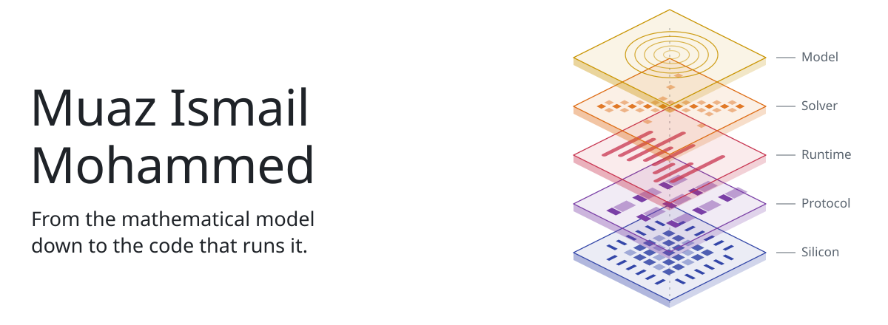
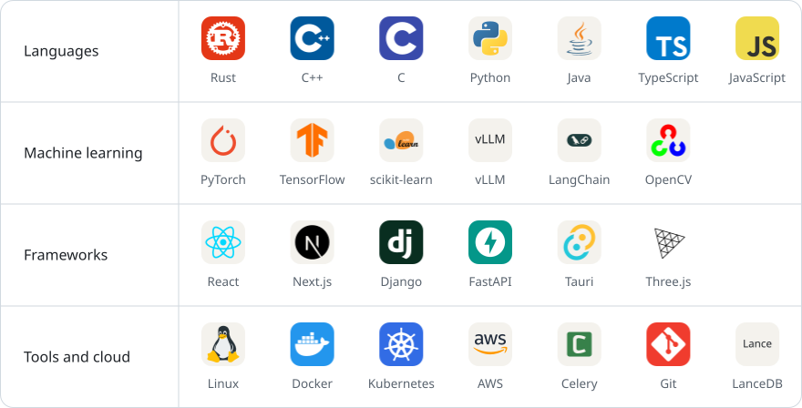

<picture>
  <source media="(prefers-color-scheme: dark)" srcset="assets/banner-v2-dark.svg">
  
</picture>

I'm a Computer Science undergraduate at A J Institute of Engineering and Technology in Mangaluru. I work mostly on systems-level software, such as optimization solvers, sandboxed code execution, inference engines and simulation, and I care most about correctness and performance.

 

  <picture>
    <source media="(prefers-color-scheme: dark)" srcset="assets/title-achievements-dark.svg">
    
  </picture>

<table>
  <tr>
    <td align="center" width="21%"></td>
    <td><b>FOSS Hack 2026</b>, with a Rs 1,00,000 prize <a href="https://github.com/MuazTPM-YT/libre-mp">LibreMP</a>: we reverse-engineered Epson's projector protocol from packet captures, so Linux and macOS can cast too.</td>
  </tr>
  <tr>
    <td align="center"></td>
    <td><b>FortyGuard Hackathon 2026</b>, among teams from 50+ countries <a href="https://github.com/MuazTPM-YT/satalite">SatAlite</a>: predicts how a concrete pour cures, from satellite temperature data and a 2D finite-difference heat solver.</td>
  </tr>
  <tr>
    <td align="center"></td>
    <td><b>Meta PyTorch OpenEnv Hackathon</b>, out of 32,000+ participants Memex: an RL-trained agent that investigates money-laundering cases across 18 tools.</td>
  </tr>
  <tr>
    <td align="center"></td>
    <td><b>Amazon ML Challenge 2026</b>, out of 20,000+ participants</td>
  </tr>
  <tr>
    <td align="center"></td>
    <td><b>Sahyadri Coastal Innovation Hackathon 2026</b>, national finalist</td>
  </tr>
</table>

Also a Codeforces Specialist, and shortlisted for IICPC CodeFest 2026.

 

  <picture>
    <source media="(prefers-color-scheme: dark)" srcset="assets/title-stack-dark.svg">
    
  </picture>

<picture>
  <source media="(max-width: 1011px) and (prefers-color-scheme: dark)" srcset="assets/stack-narrow-dark.svg">
  <source media="(max-width: 1011px)" srcset="assets/stack-narrow-light.svg">
  <source media="(prefers-color-scheme: dark)" srcset="assets/stack-v3-dark.svg">
  
</picture>

  

  <picture>
    <source media="(prefers-color-scheme: dark)" srcset="assets/title-contact-dark.svg">
    
  </picture>

  <a href="mailto:6muazx@gmail.com"><picture><source media="(prefers-color-scheme: dark)" srcset="assets/contact-email-dark.svg"></picture></a>
  <a href="https://www.linkedin.com/in/muaz-ismail-mohammed"><picture><source media="(prefers-color-scheme: dark)" srcset="assets/contact-linkedin-dark.svg"></picture></a>
  <a href="https://muaz-ismail-mohammed.vercel.app"><picture><source media="(prefers-color-scheme: dark)" srcset="assets/contact-portfolio-dark.svg"></picture></a>

