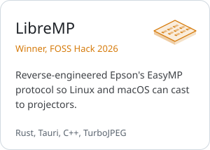
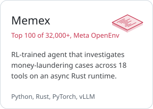
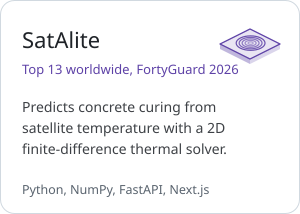

<picture>
  <source media="(prefers-color-scheme: dark)" srcset="assets/banner-v2-dark.svg">
  
</picture>

I'm a Computer Science undergraduate at A J Institute of Engineering and Technology in Mangaluru (class of 2028, CGPA 9.08). I work mostly on systems-level software, such as optimization solvers, sandboxed code execution, inference engines and simulation, and I care most about correctness and performance.

### Selected work

<a href="https://github.com/MuazTPM-YT/libre-mp"><picture><source media="(prefers-color-scheme: dark)" srcset="assets/card-libremp-dark.svg"></picture></a>
<picture><source media="(prefers-color-scheme: dark)" srcset="assets/card-memex-dark.svg"></picture>
<a href="https://github.com/MuazTPM-YT/satalite"><picture><source media="(prefers-color-scheme: dark)" srcset="assets/card-satalite-dark.svg"></picture></a>

Other results: top 500 in the Amazon ML Challenge 2026, top 10 national finalist at the Sahyadri Coastal Innovation Hackathon 2026, and Codeforces Specialist.

### Stack

<picture>
  <source media="(prefers-color-scheme: dark)" srcset="assets/stack-v2-dark.svg">
  
</picture>

### Contact

<a href="mailto:6muazx@gmail.com"><picture><source media="(prefers-color-scheme: dark)" srcset="assets/contact-email-dark.svg"></picture></a>
<a href="https://www.linkedin.com/in/muaz-ismail-mohammed"><picture><source media="(prefers-color-scheme: dark)" srcset="assets/contact-linkedin-dark.svg"></picture></a>
<a href="https://muaz-ismail-mohammed.vercel.app"><picture><source media="(prefers-color-scheme: dark)" srcset="assets/contact-portfolio-dark.svg"></picture></a>
