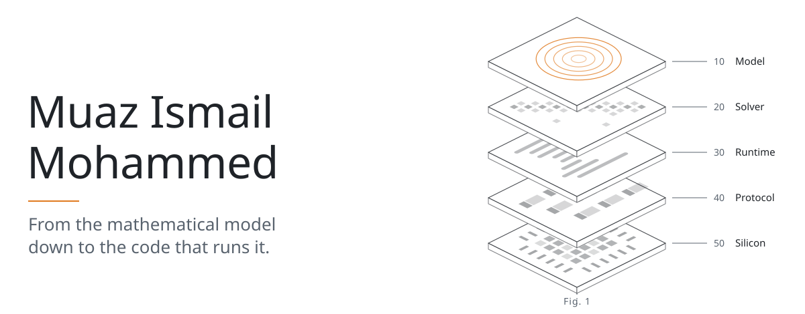
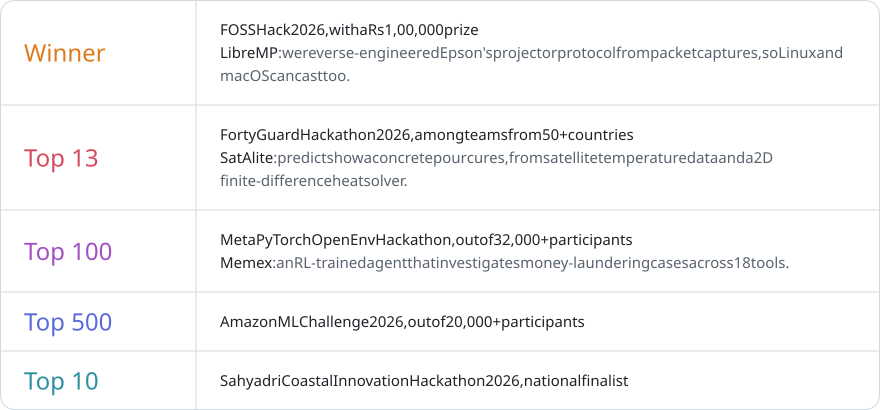
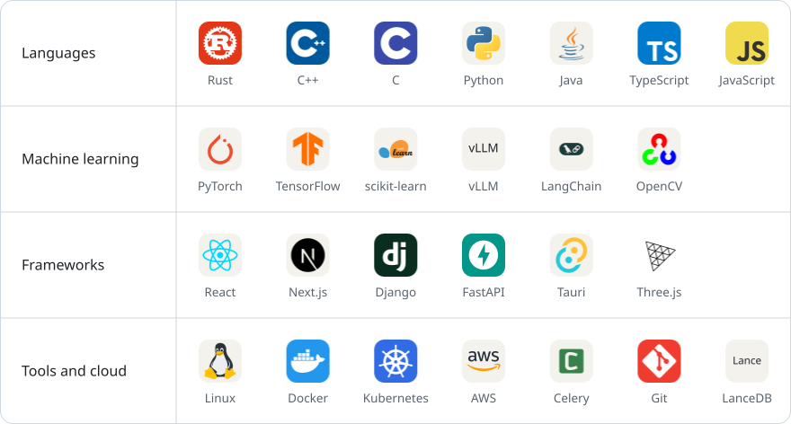

<picture>
  <source media="(prefers-color-scheme: dark)" srcset="assets/banner-v4-dark.svg">
  
</picture>

I'm a Computer Science undergraduate at A J Institute of Engineering and Technology in Mangaluru. I work mostly on systems-level software, such as optimization solvers, sandboxed code execution, inference engines and simulation, and I care most about correctness and performance.

 

  <picture>
    <source media="(prefers-color-scheme: dark)" srcset="assets/title-achievements-dark.svg">
    
  </picture>

<picture>
  <source media="(max-width: 1011px) and (prefers-color-scheme: dark)" srcset="assets/achievements-narrow-dark.svg">
  <source media="(max-width: 1011px)" srcset="assets/achievements-narrow-light.svg">
  <source media="(prefers-color-scheme: dark)" srcset="assets/achievements-dark.svg">
  
</picture>

 

  <picture>
    <source media="(prefers-color-scheme: dark)" srcset="assets/title-stack-dark.svg">
    
  </picture>

<picture>
  <source media="(max-width: 1011px) and (prefers-color-scheme: dark)" srcset="assets/stack-narrow-v4-dark.svg">
  <source media="(max-width: 1011px)" srcset="assets/stack-narrow-v4-light.svg">
  <source media="(prefers-color-scheme: dark)" srcset="assets/stack-v4-dark.svg">
  
</picture>

  

  <picture>
    <source media="(prefers-color-scheme: dark)" srcset="assets/title-contact-dark.svg">
    
  </picture>

  <a href="mailto:6muazx@gmail.com"><picture><source media="(prefers-color-scheme: dark)" srcset="assets/contact-email-dark.svg"></picture></a>
  <a href="https://www.linkedin.com/in/muaz-ismail-mohammed"><picture><source media="(prefers-color-scheme: dark)" srcset="assets/contact-linkedin-dark.svg"></picture></a>
  <a href="https://muaz-ismail-mohammed.vercel.app"><picture><source media="(prefers-color-scheme: dark)" srcset="assets/contact-portfolio-dark.svg"></picture></a>

