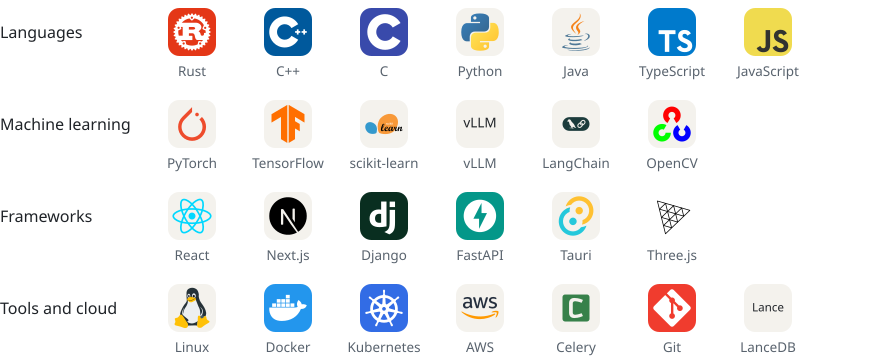

<picture>
  <source media="(prefers-color-scheme: dark)" srcset="assets/banner-dark.svg">
  
</picture>

I'm a Computer Science undergraduate at A J Institute of Engineering and Technology in Mangaluru (class of 2028, CGPA 9.08). I work mostly on systems-level software, such as optimization solvers, sandboxed code execution, inference engines and simulation, and I care most about correctness and performance.

### Selected work

**[LibreMP](https://github.com/MuazTPM-YT/libre-mp)**, winner of FOSS Hack 2026\
Epson projectors only cast from Windows. I reverse-engineered the EasyMP network protocol from packet captures so Linux and macOS can cast too.\
Rust, Tauri, React, C++, TurboJPEG

**Memex**, top 100 of 32,000+ at the Meta PyTorch OpenEnv Hackathon\
An RL-trained agent (GRPO) that investigates money-laundering cases across 18 tools, backed by an async Rust tool runtime.\
Python, Rust/Tokio, PyTorch, vLLM

**[SatAlite](https://github.com/MuazTPM-YT/satalite)**, top 13 internationally at the FortyGuard Hackathon 2026\
Predicts how a concrete pour cures without sensors: a 2D finite-difference thermal solver on 100 m satellite temperature data, with Monte Carlo p05/p95 bands.\
Python, NumPy, FastAPI, Next.js, Three.js

**MuazGPT**\
A fully local personal AI agent with a from-scratch inference engine, built to run on a laptop within 1 GB of VRAM.\
Rust, Python, BM25 and vector hybrid search

Now building Vectorium, a 3D teaching sandbox for engineering drawing that runs LLM-generated code in Firecracker microVMs, and Timely.ai, a university timetable generator with a constraint-solving engine.

Smaller tools: [mpp](https://github.com/MuazTPM-YT/mpp), a language for tests and statistics on a bytecode VM; [cih-2026](https://github.com/MuazTPM-YT/cih-2026), a telemedicine gateway that keeps delivering over lossy links with RaptorQ; and [testcasevim.nvim](https://github.com/MuazTPM-YT/testcasevim.nvim), which runs competitive programming test cases inside Neovim.

### Experience

- **NTech**, Software Head and Lead Architect (2026). Led 4 engineers on an ERP system and built its ZATCA (Saudi e-invoicing) cryptographic compliance module.
- **Freelance data science** (2021–2024). Demand-forecasting and customer-behaviour models for 87+ clients.
- **GloryNetwork**, server and backend (2019–2022). Real-time sync for a network peaking at 27,000+ concurrent players, and a packet-level anti-cheat engine.

Other results: top 500 in the Amazon ML Challenge 2026, top 10 national finalist at the Sahyadri Coastal Innovation Hackathon 2026, and Codeforces Specialist.

### Stack

<picture>
  <source media="(prefers-color-scheme: dark)" srcset="assets/stack-dark.svg">
  
</picture>

### Contact

<a href="mailto:6muazx@gmail.com"><picture><source media="(prefers-color-scheme: dark)" srcset="assets/contact-email-dark.svg"></picture></a>
<a href="https://www.linkedin.com/in/muaz-ismail-mohammed"><picture><source media="(prefers-color-scheme: dark)" srcset="assets/contact-linkedin-dark.svg"></picture></a>
<a href="https://muaz-ismail-mohammed.vercel.app"><picture><source media="(prefers-color-scheme: dark)" srcset="assets/contact-portfolio-dark.svg"></picture></a>
